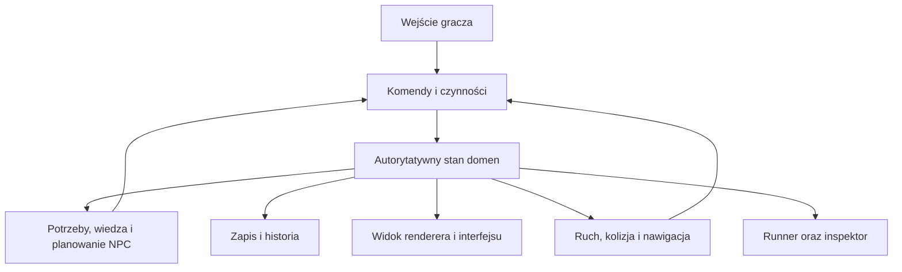

# Architektura Reality Engine

**Status: granice docelowe; wdrożono fundament M00, model M01, laboratorium M02 i ograniczony ruch M03.** Dowody oraz granice odbioru są w raportach etapów; kierunki produktu wynikają z [karty](project-charter.md), a status technologii z [decyzji](decisions.md).

## Wdrożony fundament

[SimulationClock](../src/core/simulation_clock.hpp) jest małym współdzielonym modułem C++20. Ma dodatni stały krok w nanosekundach i jawny postęp. Odrzuca niedozwolony krok oraz przepełnienie przed zmianą stanu. Korzystają z niego [program konsolowy](../src/headless/main.cpp) i [testy](../tests/clock_tests.cpp). Nie jest schedulerem ani symulacją mieszkańców; nie zapisuje świata i nie korzysta z zegara ściennego.

[Model czynności](work-domain.md) opisuje rzeczywiste `EntityRegistry`, `WorkWorld`, codec oraz zapis pliku. Domenowy świat jest jedynym właścicielem rezerwacji, czasu i skutków. Codec buduje osobnego kandydata przy odczycie; warstwa pliku izoluje Windows API. Konsumentem jest demo konsolowe i testy, w tym kontynuacja między procesami. Nie powstały jeszcze niezależne moduły EARTH, EVOLUTION ani pełny World.

Pozostałe odpowiedzialności w tabeli są wymaganiami architektonicznymi, nie deklaracją implementacji. Narzędzia diagnostyczne oraz rzeczywiste komendy wskazuje [środowisko pracy](development.md).

[Laboratorium M02](window-laboratory.md) dodaje `LabSession`, akumulator stałego kroku, proceduralną geometrię i kamerę, backend D3D11 oraz okno Win32 z kontrolkami. Renderer przyjmuje rzutowane trójkąty, bez dostępu do mutowalnego świata. Kontrolki kierują operacje do konsumenta M01. Pozycje znaczników są układem narzędzia, nie fizyką. [Raport](verification/m02-window-laboratory.md) zawiera działanie sprzętowe oraz zaliczoną próbę warstwy diagnostycznej GPU.

## Struktura logiczna

[Model ruchu M03](motion-navigation.md) dodaje własną kinematykę i A*, konsumowane przez `MotionSession`. Ten konsument posiada geometrię, położenia i trasy, zachowując referencję do jednego `LabSession`/`WorkWorld`. Reguły fizyki i nawigacji nie znają fikcji, grafiki ani Windows. Zapis używa otoczki M03 i wspólnego atomowego I/O M01. Renderer czyta geometrię; nie steruje położeniem. M02 pozostaje oddzielnym statycznym trybem narzędzia.

Po [audycie praktycznym](verification/motion-adversarial-audit.md) ten sam konsument przechowuje pochodną historię ostatniego kroku do interpolacji obrazu; nie zapisuje jej i nie używa do przesuwania świata. Kinematyka dostarcza rzeczywiste segmenty kontaktu/ślizgu, a UI wybiera widoczne interpolowane bryły. Nowe przyłącza nawigacji i lokalna próba obejścia osoby nadal korzystają z jednego źródła geometrii oraz sweepu. Nie tworzymy konkurencyjnej fizyki w rendererze.

To przepływ logiczny, nie zalecenie utworzenia wielu usług lub uniwersalnego event busa. Początek stanowi lokalna aplikacja z niewielkimi modułami. Gra i runner używają tej samej biblioteki reguł domenowych.

## Granice modułów

| Odpowiedzialność | Posiada | Nie może samodzielnie robić |
| --- | --- | --- |
| Foundation | ID, jednostki, zegary, błędy i podstawowe kolekcje | Odczytywać świat przez globalny singleton |
| World | Tożsamości, miejsca, reprezentacje i protokół przekazania | Dublować życia osoby przy streamingu |
| Interaction | Fazy czynności, rezerwacje i zatwierdzanie skutku | Traktować wypowiedzi jako wykonaną transakcję |
| Physics | Aktywny ruch, kolizję i wynik kontaktów | Zmieniać własność zasobu bez kontraktu domenowego |
| Navigation | Reprezentację przejść, wersje tras i wyszukiwanie | Przenosić postać przez kolizję |
| EARTH | Gospodarstwa, produkcję, logistykę, infrastrukturę | Tworzyć awaryjne zasoby poza modelem |
| EVOLUTION | Potrzeby, przekonania, relacje i plany | Dostawać globalną prawdę bez kanału informacji |
| FORGE | Połączenia konstrukcyjne, szkody i odbudowę | Raportować prostą zmianę flagi jako fizyczny rozpad |
| CHRONICLE | Role scen, warunki i stany zakończenia | Wskrzeszać uczestnika, by naprawić misję |
| Persistence | Spójne migawki, dziennik i wersje | Po cichu zastępować uszkodzony świat nowym |
| Graphics / Platform | Widoki, zasoby GPU, okno, wejście | Przechowywać alternatywną gospodarkę lub biografię |
| Tools / Game | Diagnostykę, edycję i interfejs użytkownika | Omijać reguły czynności przy zwykłej interakcji |

To podział odpowiedzialności, nie nakaz tworzenia od razu osobnego projektu, klasy managera i katalogu dla każdego wiersza. Moduł powstaje, gdy ma działający przypadek użycia.

## Fikcja a reguły silnika

DEC-008 zatwierdza kierunek fantasy, a DEC-011 zachowuje fundamenty i plan. Tożsamości, zegary, rezerwacje, bilanse, kolizja, geometria przejść i zapis nie powinny zależeć od nazw królestw, cechów, potworów lub zaklęć. Nazwy i opisy należą do treści; reguły konkretnych zdolności mogą należeć do domeny gry. Nie ukrywamy zależności od zasad świata przez sztuczny „uniwersalny” framework.

Przyszła magia lub fantastyczna istota potrzebuje jawnych warunków, kosztów, limitów i skutków. Zmiana geometrii, zdrowia, zasobu, konstrukcji albo wiedzy przechodzi przez właściciela tej domeny i podlega testom. Renderer nie dopisuje skutku zaklęcia, a narrator nie przyznaje wiedzy bez kanału. Nie oznacza to implementacji subsystemu magii teraz ani obowiązku sprowadzenia każdej przyszłej zdolności do obecnej czynności zużywania materiału.

## Własność i granice zmiany

Każde pole ma jednego właściciela. Lokalna fizyka może wyznaczać pozycję aktywnego ciała, a model podróży położenie na odcinku trasy. Ich przełączenie jest transakcją protokołu reprezentacji, nie drugim równoległym ruchem.

Odczyty renderera i planerów korzystają ze spójnych widoków. Konfliktujące skutki są zatwierdzane w określonej kolejności. Pierwsza poprawna wersja może być sekwencyjna; równoległość wymaga dowodu potrzeby i testu kolejności.

Jednostki pieniędzy, ilości, czasu i odległości są jawne. Typ danych zapisu nie zależy od adresu pamięci ani struktur API graficznego. Często używane dane są zwarte, a rozbudowana historia pozostaje poza gorącą ścieżką.

## Czas i skala

Oddzielamy czas rzeczywisty, czas świata i krok fizyki. Rutyny, potrzeby i produkcja nie muszą aktualizować się w każdej klatce. Limity pracy zgłaszają zaległość; nie usuwają po cichu ważnych skutków.

Szczegółowość obrazu, kolizji i rozumowania to różne osie. Daleki konwój może pozostać istotny. Uproszczony ruch zachowuje zasób, trasę i czas według jawnego modelu. Równoważność modeli musi zostać sprawdzona, a nie założona.

## Pierwsza fizyka i nawigacja

Wdrożona pierwsza geometria to płaskie podłoże, osiowo ustawiony prostokątny obrys postaci, wysokość i statyczne bryły. Sweep poprzedza ruch, a A* bada tę samą geometrię i rozmiar. Ograniczenia, wejście oraz wersjonowanie określa [model ruchu](motion-navigation.md). Pełna dynamika brył, więzy i własny navmesh pozostają późniejszymi możliwościami z osobnym odbiorem.

Przejście mostowe może być początkowo przygotowanym połączeniem. Zmiana jego dostępności weryfikuje logistykę, ale nie fizyczne zawalenie. Nowe klasy geometrii wymagają odpowiednich testów z [katalogu](testing-strategy.md).

## Zapis i odtwarzanie

Migawka obejmuje także przyszłe zdarzenia, rezerwacje i działania w toku. Dziennik zapisuje zatwierdzone zmiany, a istotne niedeterministyczne wyniki mogą wymagać utrwalenia. Tożsamość bitowa fizyki między platformami nie jest obietnicą.

Rozdzielamy stan potrzebny do kontynuacji, istotną historię i tymczasową diagnostykę. Polityka retencji nie może usuwać nadal obowiązującego długu albo źródła krytycznego faktu.

## Obraz i narzędzia

Roboczy pierwszy backend i powód jego wyboru są opisane w decyzji DEC-004. Geometria proceduralna oraz proste dane scenariusza pozwalają sprawdzić grę przed budową importera i pełnego edytora. Renderer otrzymuje wynik świata; nie stanowi jego prawdy.

Panel diagnostyczny ma ujawniać plan, źródła wiedzy, rezerwacje i przyczyny skutku. Tryb diagnostyczny jest wyraźnie oddzielony od informacji dostępnej postaci.
