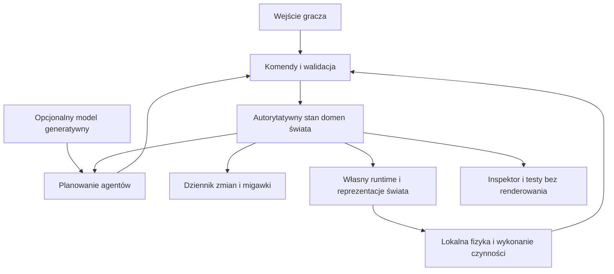

# GENESIS — architektura techniczna i wykonalność

Wersja 0.3, 25 października 2026 r. Kierunek: własny Reality Engine, fizyka i nawigacja; grywalna mała cywilizacja, prosta grafika.

Powiązane dokumenty: [koncepcja gry](PROJEKT_GENESIS.md), [analiza i program badań](GENESIS_ANALIZA_I_PROGRAM_BADAN.md), [plan pierwszych prac](GENESIS_PLAN_PRAC.md).

Decyzja o realizacji: [własny silnik — zakres, stos i etapy budowy](REALITY_ENGINE_WLASNY_SILNIK.md).

To projekt architektury, nie dokumentacja działającego silnika. W repozytorium są obecnie dokumenty koncepcyjne. Nie zbudowano jeszcze symulacji ani nie zmierzono wydajności. Poniższe decyzje są rekomendowanym punktem startowym; parametry populacji, sprzętu i jakości muszą wynikać z prób.

## 1. Czy projekt jest wykonalny?

**Tak: ograniczony, konsekwentny świat z trwałymi ludźmi, gospodarką, destrukcją i grą akcji jest rozsądnym celem inżynierskim.** Trudność polega na integracji, kosztach obliczeń, narzędziach produkcyjnych i jakości doświadczenia. Istniejące rozwiązania dostarczają istotnych części, ale nie gotowego Genesis.

**Nie mamy potwierdzenia wykonalności całego zestawu ambicji jednocześnie**, przy dowolnej populacji, jakości grafiki, czasie historii i na nieokreślonym sprzęcie. Trzeba najpierw wyznaczyć granice i udowodnić najważniejsze zachowania.

| Obszar | Ocena | Co trzeba udowodnić w Genesis |
| --- | --- | --- |
| Trwałe identyfikatory, zapis, transakcje, planowanie z ograniczeniami | Znane metody | Poprawność przy przerwaniu czynności, zapisie i zmianie reprezentacji |
| Streaming, animacja, lokalna nawigacja, rendering, fizyka brył | Własna infrastruktura i wybrane biblioteki | Poprawność implementacji oraz wydajność w scenach łączących wszystkie obciążenia |
| Ekonomia, logistyka, instytucje, pamięć | Duży projekt własny | Stabilność, sensowne reakcje i czytelność dla gracza |
| Trwała destrukcja powiązana z logistyką i historią | Trudna integracja | Zgodny stan konstrukcji, tras, zasobów i scen |
| Wieloskalowa symulacja i długie przeskoki czasu | Istotne ryzyko badawcze | Akceptowalne przybliżenia bez naruszania chronionych własności |
| Kultura, wynalazki i nowe instytucje | Badania z ograniczoną przestrzenią rozwiązań | Powtarzalne zmiany zachowania, transfer i wartość dla gry |
| Dowolna otwarta ewolucja i niekończąca się znacząca nowość | Brak gwarancji | Najpierw operacyjna definicja i eksperymenty |
| Świadomość cyfrowych istot | Osobny problem naukowy | Nie jest kryterium ukończenia gry |

## 2. Założenia początkowe

Rekomendowany pierwszy produkt: PC, jeden gracz, świat działający lokalnie i zatrzymywany po wyjściu. Pierwszy wycinek nie wymaga chmury ani modelu językowego do podstawowego funkcjonowania.

Reality Engine jest własnym silnikiem obejmującym model świata, renderer, streaming, narzędzia i integrację wyspecjalizowanych bibliotek. Projekt odchodzi od Unreal Engine. Wspólne zasady danych i czynności pozostają fundamentem.

Proponowany stos po odpowiedziach użytkownika: C++20 i CMake, samodzielny runner testowy oraz własny runtime. Roboczo pierwsza platforma to Windows z Win32 i prostym backendem Direct3D 11. Fizyka, nawigacja, zachowania i narzędzia są własne, a zależności zewnętrzne minimalne. Warianty oparte na Jolt i Recast/Detour zostały wycofane. Szczegóły i źródła zawiera dokument własnego silnika. Python może obsługiwać analizę wyników i narzędzia poza gorącą ścieżką symulacji.

Użytkownik pracuje ze swoimi agentami AI, bez narzuconego terminu. Potwierdzony sprzęt odniesienia to i5-1035G1 (4 rdzenie/8 wątków), MX330 i około 8 GB RAM. Pierwszym wspólnym wynikiem gry i laboratorium jest społeczność około 12–16 osób; wcześniejszy cel około 60 osób pozostaje następną próbą skali. Są to propozycje etapowania, a nie wyniki testów.

Wybór konkretnych wersji bibliotek i kompilatora następuje po próbie integracyjnej i zostaje utrwalony w konfiguracji budowania. Dokumentacja pokazuje możliwości, ale nie zastępuje sprawdzenia działania w przypiętej wersji. Własny renderer i narzędzia zwiększają zakres prac oraz wymagają osobnych pomiarów.

## 3. Architektura wykonania



Diagram pokazuje przepływ logiczny. Początkowo jest to jeden program z modułami i kilkoma kontrolowanymi kolejkami. Nie potrzebujemy sieci mikroserwisów. Runner laboratoryjny uruchamia te same reguły domenowe bez renderowania; szczegółową fizykę może zastępować jawnym, testowanym modelem uproszczonym. Wyniki tych modeli nie są automatycznie równoważne.

Rdzeń odpowiada za tożsamość, własność, cele, gospodarkę i trwałe skutki. Integracja obsługuje ciała, animację, lokalną kolizję, dźwięk, kamerę i interfejs.

**Każde pole stanu ma jednego właściciela.** Lokalny solver fizyki może być właścicielem bieżącej pozycji aktywnego ciała; rdzeń otrzymuje zatwierdzoną pozycję i zdarzenia. Po przejściu w ruch uproszczony własność położenia przejmuje model transportowy. Protokół przejścia zapobiega jednoczesnemu sterowaniu przez oba systemy.

Ruch gracza, trafienie i reakcja na przeszkodę mają szybką ścieżkę wykonania. Nie czekają na rzadką aktualizację ekonomii ani odpowiedź modelu. Ich trwałe skutki przechodzą przez wspólne reguły własności danych.

## 4. Dane: wspólny język wszystkich systemów

Potrzebujemy trwałych identyfikatorów niezależnych od adresu pamięci, uchwytu reprezentacji oraz wczytania komórki mapy. Krótkotrwałe uchwyty mogą zawierać licznik generacji zabezpieczający przed odwołaniem do usuniętego obiektu.

| Typ danych | Minimalna zawartość |
| --- | --- |
| Person | Tożsamość, stan ciała, kompetencje, potrzeby, cele, miejsce w świecie |
| Household | Członkowie, lokal, wspólne środki i zobowiązania |
| Organization | Członkowie, role, reguły, uprawnienia, majątek |
| Place | Położenie, funkcje, dostępność, połączenia |
| Structure | Elementy konstrukcji, podparcia, uszkodzenia, dostępne przejścia |
| ResourceLot | Rodzaj, ilość, jakość, właściciel, miejsce i rezerwacje |
| Route | Odcinki, przepustowość, ograniczenia, koszt i wersja stanu |
| Activity | Uczestnicy, faza, wymagania, koszty, czas, sposób przerwania |
| Belief | Treść przekonania, źródło, pewność, czas poznania |
| Obligation | Strony, warunki, termin, status i znane naruszenia |
| WorldEvent | Zdarzenie, przyczyny, uczestnicy, czas, wynik i wersja schematu |

Stan świata oraz przekonania o świecie są osobnymi strukturami. Świadek może się pomylić. Autor fabuły i narzędzie diagnostyczne mogą odczytywać prawdę; planer mieszkańca dostaje ograniczony widok wiedzy.

Dane często używane przechowujemy w zwartych tablicach komponentów lub podobnym układzie zorientowanym na dane. Rozbudowane wspomnienia, dokumenty i historia pozostają w danych rzadko odczytywanych. Mesh, ciało fizyczne i animacja są reprezentacjami aktywnego obiektu; jego biografia pozostaje w trwałych danych domenowych.

Pieniądze, ilości i jednostki mają jawne typy oraz reguły zaokrąglania. Model nie może przypadkowo mieszać czasu rzeczywistego z czasem świata, metrów z jednostkami edytora ani ilości dostępnej z już zarezerwowaną.

Na początku wystarczy biblioteka prostych struktur. Wybór ECS i układu danych wymaga pomiaru. Warstwa reprezentacji nie może tworzyć drugiej niezależnej gospodarki lub biografii.

## 5. Kontrakt czynności

Każde ważne działanie opisuje:

```text
ActionDefinition
  actor, targets, required_information
  physical_requirements, resources, duration
  reservations, execution_phases
  effects_on_success, effects_on_failure, effects_on_interrupt
  observation_rules, emitted_events
```

Przykład: naprawa przepompowni wymaga kompetencji, części, narzędzi, dostępnego stanowiska i czasu. Rezerwacja uniemożliwia dwóm ekipom jednoczesne zużycie tej samej części. Przy wykonaniu ponownie sprawdzamy warunki. Przerwanie zwalnia rezerwacje, ale może pozostawić zużyty materiał albo częściowo rozebraną maszynę.

Fazy: propozycja → sprawdzenie → rezerwacja → wykonanie → zatwierdzenie skutku albo przerwanie. Długie działania nie utrzymują wielosekundowej blokady całego świata. Krótkie atomowe zmiany stanu są oddzielone od czasu ich wykonywania.

Wersje odczytanego stanu wykrywają nieaktualny plan. Ponowienie komendy ma identyfikator pozwalający uniknąć podwójnego skutku. Rezerwacje mają właściciela oraz reguły wygaśnięcia i odwołania. Zniszczenie narzędzia albo śmierć wykonawcy unieważnia zależne czynności.

**Legalność w świecie nie jest tym samym co fizyczna wykonalność.** Kradzież może być możliwym działaniem, które narusza prawo i uruchamia reakcje świadków. Walidator nie powinien automatycznie blokować każdego czynu zakazanego przez lokalną władzę. Oddzielnie chronimy integralność programu i danych.

Kontrakt ma wspólną semantykę dla gracza i NPC. Gracz może inicjować działanie ręcznie, a postać planem. Animacja przekazuje sygnały wykonania, ale sama wypowiedź lub odtworzenie gestu nie tworzy transakcji.

## 6. Czas, harmonogram i współbieżność

Utrzymujemy zegar świata, czas rzeczywisty i jawny współczynnik przyspieszenia. Fizyka ma swój kontrolowany krok. Produkcja, relacje i plany korzystają z właściwych interwałów, a pilne zdarzenia mogą wybudzać odpowiednie systemy.

Nie aktualizujemy każdej potrzeby każdego mieszkańca w każdej klatce. Stały dochód może być rozliczany zdarzeniem, głód aktualizowany analitycznie od ostatniego czasu, a plan zmieniany po istotnym zaburzeniu.

Najpierw budujemy poprawny, możliwie deterministyczny rdzeń sekwencyjny. Następnie równoleglimy odczyt, niezależne regiony i obliczanie propozycji. Zatwierdzanie konfliktujących zmian ma określoną kolejność. To pozwala rozdzielić błąd modelu od błędu współbieżności.

Każde zadanie ma priorytet i limit pracy. Wyszukiwanie planu ma limit rozwiniętych stanów, a nie obietnicę znalezienia rozwiązania dowolnie trudnego problemu. Kolejki muszą ujawniać opóźnienia. Budżet klatki nie może być ratowany przez ciche pomijanie dostaw lub zapłat.

Nagłe zdarzenia mogą uruchomić tysiące reakcji. Potrzebujemy indeksów zależności, subskrypcji, scalania powtarzalnych powiadomień i rozłożenia niepilnego przeplanowania w czasie. Nie wolno przy tym zgubić łącznej ilości szkód albo płatności.

## 7. Wieloskalowość

Oddzielamy szczegółowość obrazu, fizyki i rozumowania. Daleki człowiek może być niewidoczny, ale bardzo ważny dla negocjacji. Bliski przechodzień może korzystać z taniego nawyku.

| Poziom | Reprezentacja | Zachowane własności |
| --- | --- | --- |
| Lokalny | Ciało, animacja, percepcja, kolizja | Stan osoby, zasoby, pozycja i skutki fizyczne |
| Miejscowości | Działania i przemieszczanie po grafie miejsc | Tożsamości, czas, plany, bilanse, rezerwacje |
| Regionu | Zdarzenia, partie transportowe, przepływy | Własność, ilości, terminy, istotna historia |
| Długiego czasu | Przyspieszone zdarzenia i ograniczone przybliżenia | Jawnie zdefiniowane bilanse i ciągłość ważnych osób |

Minimalny przykład przejścia: konwój ma jedną partię ładunku, trasę, postęp na odcinku i rezerwację pojazdu. Po wczytaniu jego otoczenia tworzymy reprezentację w zgodnym miejscu. Nie losujemy nowej zawartości ciężarówki.

Przed przekazaniem reprezentacji zatrzymujemy starego właściciela ruchu, przekazujemy stan, potwierdzamy nowego i dopiero zwalniamy poprzednie zasoby. Histereza ogranicza ciągłe przełączanie przy granicy obszaru.

Po zawaleniu mostu oznaczamy odcinek jako niedostępny i unieważniamy zależne plany. Model uproszczony musi zawierać zdarzenia, które mogą zmienić wynik poza widokiem, np. awarię czy spotkanie z blokadą. Ich prawdopodobieństwa są założeniami modelu wymagającymi testów, nie odpowiednikiem szczegółowej fizyki.

## 8. EVOLUTION: umysł mieszkańca

Pipeline: percepcja → przekonania → potrzeby i zobowiązania → wybór celu → ograniczony plan → wykonanie czynności → ocena wyniku → pamięć.

Percepcja wykorzystuje lokalne indeksy przestrzenne i filtrowanie kandydatów przed kosztownymi testami widoczności. Hałas i komunikacja mają zasięg oraz drogę propagacji. Nie przeliczamy relacji wszystkich ze wszystkimi.

Planowanie łączy ocenę priorytetów z hierarchią znanych procedur. HTN może rozbijać zadanie na kroki, a ograniczone wyszukiwanie GOAP pomagać tam, gdzie potrzeba elastycznego doboru działań. Pierwsza własna wersja zaczyna się od niewielkiego katalogu procedur i jawnej kontroli ich wymagań. Nie ma powodu używać kosztownego wyszukiwania do każdej rutyny.

Zachowania lokalne — podejście do stanowiska, ucieczka, zajęcie osłony — wykonuje system stanów albo drzewo zachowań. Plan wielodniowy nie kieruje bezpośrednio każdą animacją.

Pamięć zawiera krótkie doświadczenia, ważne zobowiązania i wiedzę uporządkowaną według źródła. Streszczenia nie zastępują dokładnych danych o długu, własności i śmierci. Wyszukiwanie wektorowe jest opcją do tekstów, a nie wymaganiem do każdej decyzji.

Sieć relacji jest rzadka: szczegółowe więzi dotyczą ludzi faktycznie znanych, reszta korzysta z opinii o grupie albo braku informacji. Zapobiega to kosztowi rosnącemu kwadratowo z populacją.

Uczenie początkowo oznacza aktualizowanie przewidywań, wybór skuteczniejszych procedur i zachowywanie doświadczeń. Trening sieci podczas rozgrywki jest późniejszą hipotezą, nie fundamentem pierwszego prototypu.

## 9. Modele generatywne

Pierwszy grywalny wycinek nie wymaga modelu językowego. Agenci AI pomagający użytkownikowi programować są odrębni od mieszkańców świata. W późniejszym rozszerzeniu model może być opcjonalnym konsultantem: interpretować rozmowę, proponować rzadki plan i formułować wypowiedź na podstawie zatwierdzonej treści.

Wejście zawiera wiedzę postaci oraz dozwolone rodzaje propozycji. Wyjście ma sprawdzany schemat. Pomysł przechodzi walidację uprawnień technicznych, możliwości, zasobów, wiedzy i aktualności. Treść dokumentu znalezionego w grze jest danymi świata i nie może zmieniać instrukcji programu.

Usługa ma kolejkę, limity równoległości, czasu, długości kontekstu i pamięci podręcznej. Spóźniona odpowiedź zostaje odrzucona albo ponownie sprawdzona. Brak odpowiedzi uruchamia przygotowany wariant lokalny.

Przykład skali: 10 000 mieszkańców, jedna decyzja na 10 sekund, 1% decyzji przekazanych modelowi daje 10 wywołań na sekundę. To rachunek poglądowy; koszt zależy od modelu i długości kontekstu. Lokalny model konkuruje z renderingiem o pamięć i moc GPU. Model zdalny wnosi opóźnienia oraz koszt działania usługi.

Dialog wymagający zobowiązania najpierw uzgadnia możliwą transakcję, a potem ją opisuje. Generowanie zdania „zapłaciłem” nie zmienia salda.

## 10. EARTH: gospodarka, społeczeństwo i środowisko

Pierwszy model gospodarki obejmuje partie dóbr, gospodarstwa domowe, zakłady, miejsca pracy, wynagrodzenia, magazyny, zamówienia, transport i konserwację. Produkcja jawnie przekształca wejścia w wyjścia. Straty i odpady mają zapisane przyczyny.

Własność i dostępność muszą być rozdzielone: towar można posiadać, lecz mieć go w niedostępnym magazynie albo obiecać komuś innemu. Ceny można początkowo liczyć prostymi regułami zapasów i zamówień, bez symulowania zaawansowanego rynku finansowego.

Rezerwy, alternatywne trasy i awaryjna produkcja amortyzują zaburzenia. Testy obejmują także długą stabilną pracę bez gracza; permanentny kryzys nie może wynikać z błędu bilansów.

Organizacje korzystają z ról, reguł podejmowania decyzji, majątku i zobowiązań. Prawo potrzebuje rozpoznania zdarzenia, dowodów i wykonawców sankcji. Poparcie i reputacja są lokalnymi ocenami wynikającymi z informacji.

Demografia, zdrowie, migracja i dziedziczenie wymagają osobnych prostych modeli. W pierwszym wycinku zdrowie może być kilkoma znaczącymi stanami; symulacja komórek albo pełnej medycyny nie jest konieczna.

Woda, energia, transport i telekomunikacja są grafami sieci o różnych prawach przepływu. Pożar i zalanie mogą korzystać z lokalnych siatek i ograniczonych modeli. Globalna symulacja płynów o dokładności inżynierskiej nie jest założeniem produktu.

## 11. FORGE: destrukcja i odbudowa

Rozdzielamy graf konstrukcji, stan użytkowy oraz wizualny przebieg rozpadu. Artysta oznacza podpory, połączenia, instalacje, wejścia i dopuszczalne klasy uszkodzeń.

Lokalna fizyka wyznacza istotne skutki w aktywnej scenie. FORGE zapisuje m.in. zerwane połączenia, dostępne przejścia, obciążenia użytkowe i trwałe przeszkody. Odłamki dekoracyjne mogą wygasać, a gruz blokujący przejście wymaga zachowania kolizji lub jej zgodnego uproszczenia.

Duża destrukcja wymaga także aktualizacji lokalnej nawigacji, grafu dróg, połączeń instalacji, oświetlenia i odległych reprezentacji. Sam efekt zawalenia nie zapewnia tych powiązań.

Odbudowa jest sekwencją rezerwacji materiałów, pracy, dostaw i bezpiecznych etapów. Nowy obiekt może zastąpić starą konstrukcję, lecz historia miejsca i koszty pozostają.

## 12. Gra akcji i prezentacja

Osobne obszary produkcji to: sterowanie i kamera, lokomocja, wspinaczka, pływanie, pojazdy, walka, trafienia, medycyna polowa, interakcje, ekwipunek, animacja, dźwięk oraz interfejs.

Wspólna definicja interakcji opisuje punkt podejścia, wymagane narzędzie, pozycję ciała, fazę wykonania i możliwość przerwania. Najpierw budujemy kilka uniwersalnych czasowników; każdy wymaga pokrycia animacją i testem.

Rendering potrzebuje streamingu, instancjonowania, geometrii o różnej szczegółowości, budżetu animacji i kontroli efektów. Oświetlenie, cienie i kolizja muszą reagować na istotne zmiany konstrukcji. Odległa reprezentacja nie może stale pokazywać nieistniejącego mostu.

Dialog obejmuje napisy, kolejkę, przerywanie i bezpieczny powrót do rozmowy. Opcjonalny głos wymaga osobnego budżetu opóźnień, pamięci, produkcji i licencji. Projekt powinien działać również bez mikrofonu.

## 13. CHRONICLE i narzędzia autorskie

Scena opisuje wymagane role, wiedzę, miejsce, przedmiot konfliktu, warunki rozpoczęcia i stany zakończenia. Narzędzie sprawdza, czy warunki nie są sprzeczne oraz czy istnieje zakończenie po śmierci uczestnika, zniszczeniu miejsca albo wcześniejszym zabraniu przedmiotu.

Autorzy potrzebują edytora zależności i możliwości uruchomienia sceny z różnymi stanami świata. Dodanie historii nie powinno wymagać ręcznego zaprogramowania nowego wyjątku w gospodarce.

Najważniejsze narzędzie diagnostyczne odpowiada: dlaczego agent podjął decyzję, co wie, co zarezerwował, jaki warunek planu przestał obowiązywać i skąd pochodzi dana zmiana.

Model relacji i autorzy dbają o indywidualne osobowości. Sam generator zleceń nie zapewnia jakości dialogu, postaci ani tempa kampanii.

## 14. Zapis, odtwarzanie i historia

Zapis obejmuje migawkę spójnego stanu oraz dziennik zatwierdzonych zmian od tej migawki. Stan zawiera rezerwacje, częściowo wykonane działania, własność, szkody, przekonania i zobowiązania.

Potrzebujemy granicy migawki, kontroli integralności, wersjonowania schematów, migracji i zachowania ostatniego poprawnego zapisu po nieudanej operacji. Testujemy przerwanie zapisu oraz ponowne uruchomienie.

Stałe ziarno nie gwarantuje identycznej fizyki, generowania ani kolejności wątków. Dla odtwarzania wyników zapisujemy autorytatywne rezultaty niedeterministycznych operacji. Dla porównań badawczych czasem potrzebna jest seria prób zamiast jednej identycznej powtórki.

Nie zapisujemy bez końca każdego ruchu palca i każdej klatki. Rozdzielamy stan niezbędny do kontynuacji, istotną historię świata oraz czasowy ślad diagnostyczny. Archiwizacja i streszczenia mają jawne reguły zachowania zobowiązań oraz pochodzenia ważnych faktów.

Przykład arytmetyczny: 100 000 zdarzeń dziennie po 128 bajtów to 12,8 MB dziennie przed indeksami, tekstem i kompresją. Po 100 dniach daje to 1,28 GB. To pokazuje potrzebę polityki historii; nie prognozuje faktycznego rozmiaru zapisu.

## 15. Rozszerzenia badawcze

Kultura wymaga reprezentacji praktyki, kanału przekazania, kosztu i obserwowalnego zastosowania. Wynalazczość wymaga języka składania mechanizmów oraz testowania działania. Nowe instytucje wymagają wykonawczych reguł członkostwa, własności i decyzji.

Wszystkie te przestrzenie są ograniczone tym, co silnik potrafi reprezentować. Skończony program i budżet nie dają gwarancji niekończącej się znaczącej nowości.

Badania prowadzi runner laboratoryjny z porównaniami do prostszych wariantów i budżetem obliczeń. Do produktu przechodzą rozwiązania wykazujące wartość i stabilność. Eksperymenty sztucznego życia oraz rozważania o świadomości nie blokują pierwszej grywalnej wersji.

## 16. Własne technologie i biblioteki fundamentowe

| Element | Punkt startowy | Własna odpowiedzialność |
| --- | --- | --- |
| Okno, wejście, wyjście audio | Systemowe API Windows; roboczo Win32 dla okna i wejścia | Cykl aplikacji, akcje gracza; audio rozwijane później |
| Rendering, materiały i kamera | Własny prosty kod nad Direct3D 11 | Geometria, głębia, kolory, bufory i synchronizacja |
| Streaming mapy | Własny World | Pakiety, komórki, priorytety i ciągłość życia świata |
| Reprezentacje populacji | Własne komponenty i polityki szczegółowości | Mapowanie tożsamości, reguły ważności i migracja stanu |
| Lokalna rutyna | Własne procedury i system stanów | Kontrakty, plany i cele |
| Punkty interakcji | Własny Interaction | Rezerwacje, wykonanie, animacja i skutki domenowe |
| Destrukcja fizyczna | FORGE, przygotowane elementy i własny solver rozwijany etapami | Połączenia konstrukcyjne, trwałość, infrastruktura i odbudowa |
| Ruch w przestrzeni | Własna mapa przejścia 2,5D, A* i graf regionu | Ruch z kolizją, transport i przeliczenia po zmianie świata |
| Animacja | Własny system klipów, szkieletów i przejść | Skinning, interakcje, przerwania i budżet animacji |
| Profilowanie | Własne liczniki i systemowe zegary | Ślady przyczynowe i mierniki symulacji |
| Import i edytor | Najpierw bryły proceduralne, dane scenariusza i prosty inspektor | Później importer, kompilator zasobów, walidacja i pełniejsze narzędzia |
| Gospodarka, wiedza, instytucje | Własny rdzeń | Reguły, zapis i poprawność |

Gotowe biblioteki fizyki i nawigacji nie należą do planu wykonawczego. Systemowe API oraz narzędzia budowania pozostają fundamentem. Nie ma jeszcze implementacji. [Dokument własnego silnika](REALITY_ENGINE_WLASNY_SILNIK.md) opisuje zakres odpowiedzialności, testy własnych systemów i źródła pierwotne.

## 17. Technologie wcześniej zbyt słabo uwzględnione

Nie da się zagwarantować kompletności samej listy. Utrzymujemy macierz: obietnica dla gracza → wymagane reguły → dane → systemy wykonania → narzędzia autora → test → koszt → właściciel.

| Obszar | Dlaczego jest konieczny |
| --- | --- |
| Kompilacja danych świata | Wykrywanie błędów jednostek, brakujących identyfikatorów i niemożliwych recept przed uruchomieniem |
| Koordynacja czynności | Rezerwacje, anulowanie, odzyskiwanie po przerwaniu i kontrola konfliktów |
| Ślad przyczynowy | Rozróżnienie emergencji, błędu i nieaktualnej wiedzy |
| Nawigacja po destrukcji | Zachowanie przejezdności i planów po zmianie geometrii |
| Ciągłość reprezentacji | Bezpieczna zmiana właściciela ruchu, ciała i aktywnego wykonawcy |
| Zarządzanie historią | Kontrola wielkości pamięci, zapisów i tekstów |
| Zmiany wersji produktu | Migracje zapisów, schematów oraz definicji zasobów |
| Produkcja assetów | Modułowe konstrukcje, punkty interakcji, animacje i warianty odbudowy |
| Budowanie i pakowanie | Powtarzalne kompilacje, cache danych, test dystrybucyjnej wersji |
| Kontrola wersji | Kod, duże pliki, blokowanie konfliktujących assetów i historia zmian |
| Testy długich sesji | Narastające zaległości, wycieki, zapętlenia i rozrost historii |
| Lokalizacja i dostępność | Napisy, czytelne źródła informacji, sterowanie bez głosu, skalowanie interfejsu |
| Treści generowane | Spójność faktów, obsługa błędów modelu i zgodność z tonem świata |
| Modyfikacje i skrypty | Wersjonowane API, ograniczony czas wykonania, migracje i diagnostyka |
| Integracja sieciowa, jeśli powstanie | Autorytet serwera, replikacja, oszustwa, wiele aktywnych obszarów i konfliktujące działania graczy |

Multiplayer byłby dodatkowym programem technicznym. Wspólna warstwa komend pomaga przygotować granicę, ale nie czyni gry automatycznie gotową do sieci.

## 18. Budżety i pomiary

Sprzętem odniesienia jest laptop użytkownika z i5-1035G1, MX330 i około 8 GB RAM. Robocza propozycja pierwszej próby to 1280×720, około 12–16 mieszkańców, prosta grafika i miękki budżet procesu 512 MiB. Wstępny cel 60 FPS oznacza około 16,67 ms na klatkę. Są to budżety do sprawdzenia, nie osiągnięte wyniki. 60 mieszkańców wymaga kolejnej próby.

CPU i GPU wykonują część pracy równolegle; nie sumujemy mechanicznie wszystkich czasów. Mierzymy ścieżkę krytyczną, opóźnienie wejścia, percentyle czasów klatek, liczbę przycięć, czas oczekiwania na plany i zaległość aktualizacji świata.

Osobne limity otrzymują: pamięć RAM i VRAM, aktywne ciała, animacje, zapytania nawigacji, promienie percepcji, rozwinięcia planów, wywołania modeli, rozmiar zapisów i czas wczytywania. Każdy limit ma miernik i sposób ograniczenia kosztu.

Próby obejmują spokojną ulicę, tłum, walkę, pościg ze streamingiem, dużą destrukcję i długą sesję z wieloma skutkami. Głębokość symulacji oceniamy także podczas obciążonej grafiki. Zdolność uruchomienia dużej populacji bez renderowania nie potwierdza płynnej gry 3D.

## 19. Sposób prowadzenia prac

Każdy system ma mały kontrakt danych, właściciela i scenariusz sprawdzający. Zmiana formatu identyfikatorów albo zasad rezerwacji wymaga jawnej decyzji architektonicznej. Implementujemy pionowe fragmenty obejmujące kilka warstw, zamiast latami rozwijać moduły bez integracji.

Przykładowy fragment: gracz uszkadza most → trasa staje się niedostępna → konwój zmienia plan → dostawa się opóźnia → zakład zużywa rezerwę → mieszkaniec poznaje sytuację → scena odnosi się do zdarzenia → zapis zachowuje całość.

Codziennie powinien istnieć działający build. Zmiana przechodzi test poprawności, test istotnego scenariusza i odpowiedni pomiar kosztu. Dłuższe przebiegi są uruchamiane automatycznie w osobnym runnerze. Błąd losowego scenariusza zapisujemy jako mały przypadek regresji.

Projekt realizuje użytkownik z pomocą swoich agentów AI. Role obejmują inżynierię symulacji i danych, własną fizykę i nawigację, grafikę, narzędzia, rozgrywkę oraz weryfikację. Zadania mają mały zakres, kontrakt danych i test. Pomoc agentów nie zastępuje kompilacji, przeglądu, obserwacji rozgrywki ani pomiarów. Brak narzuconego terminu pozwala pogłębiać systemy kolejno; nie uzasadnia jednoczesnego rozszerzania wszystkich obszarów.

Pierwsza kolejność prac, kryteria przejścia i plan orientacyjnych iteracji znajdują się w [planie prac](GENESIS_PLAN_PRAC.md).
