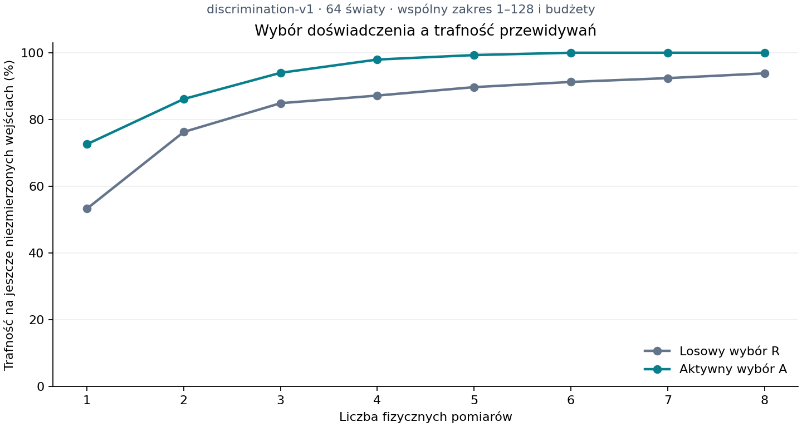

# Doświadczenia rozdzielające — wynik discrimination-v1

**Status: UKOŃCZONE w zakresie protokołu.** Audyt, implementacja, uwagi review, pełne profile i jednorazowa próba potwierdzająca zostały wykonane. Kryteria [protokołu](../work-items/discriminating-experiment.md) pozostały bez zmian. [API](../discriminating-learning.md) opisuje istniejący konsument C++; [plan wykonania](../work-items/discriminating-implementation.md) rozlicza zakres. To osobne laboratorium z rzeczywistą pracą mieszkańców, bez zmiany odbioru M04, ogólnej autonomii potrzeb ani prezentacji gry.

## Wynik i jego znaczenie

Agent A zachowuje konkurencyjne wyjaśnienia, wybiera fizyczne doświadczenie rozdzielające ich przewidywania i poprawnie identyfikuje zachowanie aparatu w skończonym języku. W 64 światach końcowe prognozy i 1280 dodatnich zadań były poprawne. Przewaga uczenia aktywnego nad losowym spełniła zapisane kryterium A.

Sprawdzona zdolność działa także w jednym zadaniu mieszkańca: dobór łańcucha kalibruje napęd i pozwala wykonać konserwację, rzeczywiście zużywając część w WorkWorld. Drugi mieszkaniec przejął wiedzę podczas fizycznego spotkania i wykonał pracę 64/64. Jednak bez wiadomości wykonał 62/64, więc **pełna hipoteza T nie otrzymała wsparcia**. Udane przejęcie metody i dowód jej dużej przewagi w populacji są różnymi twierdzeniami.

To identyfikacja zachowania ze skończonej gramatyki i planowanie interwencji. Język, miernik, cele oraz algorytm poszukiwania dostarczyliśmy my. Nie jest to dowód świadomości, własnej motywacji, nowej fizyki ani otwartej ewolucji.

## Audyt aparatury

[Pełny wynik](evidence/discriminating-2026-10-28/apparatus-audit.json): 20440 zapisów gramatyki, 2370 różnych tabel 0–128. Wszystkie mają f(0)=0. Na dawnych wejściach 1–64 istnieje 1397 klas obserwacyjnych; 150 grup obejmuje 1123 nierozróżnialne modele. Największa grupa ma 526 modeli, łącznie 139219 nierozróżnialnych par.

Przykład: `loss48→fraction12` i `loss48→cap16→fraction12` zgadzają się na wszystkich 1–64. Pierwsza różnica jest przy 66; przy 96 dają 36 i 12. Ponieważ elementy są pasywne, łańcuch z wejściem≤64 nie wytwarza większego wejścia pośredniego i nie usuwa tej bariery informacyjnej.

Rozwinięcie wszystkich możliwych wyników strategii minimaksowej na 1–128 daje 2370 jednoelementowych liści i maksymalnie 7 pomiarów, bez nierozstrzygniętych przypadków. To dowód dla tego skończonego języka i polityki, nie dowód optymalnego drzewa. Równoważnych składni o tej samej tabeli nie odróżni żaden dostępny łańcuch. Zachowania poza dziedziną i praw spoza języka nie da się zagwarantować na podstawie skończonego pomiaru.

## Zamrożenie i uczciwe porównanie

Źródła i binarium zamrożono w czystym `dcab458`, przed wygenerowaniem praw i zadań potwierdzających, 28.10.2026 o 08:38:21.976824 UTC. [Freeze](evidence/discriminating-2026-10-28/freeze.json) wiąże 138 wybranych źródeł, protokół, plan, faktyczną konfigurację, seedy, wykluczone tabele rozwojowe i binarium. SHA-256 programu: `02a324b6b25af6cf144629229974dc98ebc6e1dae682a5fe48d939e989deb53e`.

MSVC 19.44.35226.0, x64, RelWithDebInfo, ASanOFF; CMake 4.4.4 i MSBuild 17.14.40.60911. Wkompilowany `--metadata` sprawdza źródła i faktycznie skompilowaną konfigurację; pakiet zawiera także użyte CMakeCache i definicję kompilatora. Rekord gotowości wymaga dokładnego READY oraz zgodnych hashy. Przegląd i naprawy opisano [osobno](evidence/discriminating-2026-10-28/review.md): reviewer zgłosił REQUEST CHANGES, a autor zamknął uwagi regresjami i pełnymi testami; nie przypisujemy reviewerowi ponownego zatwierdzenia po poprawkach.

A i R dostają te same 2370 klas, urządzenie, zakres 1–128, cele i sufity. Każdy wykonuje 8 różnych pomiarów u, do 1024 eu i 1000 kroków. Każdy umysł ma trwałe limity 10 mln prymitywów i 300 mln odczytów modeli; kolejne fazy nie zerują liczników. B ma własne te same ograniczenia obliczeń i 2 pomiary do 256 eu. Podajemy osobno jego koszty oraz koszt nauczyciela, bez uznawania przekazu za darmową wiedzę. Nie było wyczerpania limitów w próbie.

Różnica to wybór doświadczenia: R bierze następną wartość ze wspólnej permutacji, A minimalizuje największą grupę modeli po możliwym wyniku. A nie otrzymuje tabeli świata, seedu, zbioru zadań ani odpowiedzi oceny. Prognozy po prefiksach nie zwracają agentowi informacji od sędziego. Po 8 pomiarach wiedza jest zamrożona. D obejmuje tylko jeszcze niezmierzone wejścia; G obejmuje 20 dodatnich celów ujawnianych po zamrożeniu i wykonanych fizycznie.

Potwierdzenie:64 seedy `0x44561000..3F` i 16 kontroli `0x44562000..0F`. Jest 61 różnych praw głównych, 38 odrzuconych kandydatów; losowanie ze zwracaniem, bez selekcji pod skuteczność A/R. Wykluczono 8 tabel rozwojowych. Cele losowano ze zwracaniem z 3–1326 osiągalnych dodatnich par (średnio 520.546875); 20 losowań zawierało 3–20 różnych par, średnio 19.15625. Jednostką testu statystycznego jest świat, nie pojedyncza prognoza/cel.

## Wyniki potwierdzające

| Miara na 64 światach | R losowy | A aktywny |
| --- | ---: | ---: |
| Jednoznaczny model po 8 pomiarach | 10/64 | 64/64 |
| Końcowy D, niezmierzone wejścia | 7205/7680 =93.815104% | 7680/7680 =100% |
| Końcowy G, dodatnie cele | 1250/1280 =97.65625% | 1280/1280 =100% |
| Średni D po prefiksach 1–8 | 83.596143% | 93.748036% |
| Rzeczywista konserwacja nauczyciela | 61/64 | 64/64 |

**I: spełnione** — A przekracza jednocześnie 90% jednoznaczności, 95% D i 90% G. Prawdziwa tabela pozostała w zbiorze na każdym prefiksie wszystkich głównych przypadków; kontrolował to eksperymentator, nie agent.

**A: spełnione** — różnica średniej krzywej D wynosi `3901414033557199/38430407296512000`, czyli 10.1518935 pp, przy wymaganych 5 pp. Test znaków:60 wygranych, 4 przegrane, 0 remisów; jednostronne p=`679121/18446744073709551616`≈3.68152e-14≤0.025. Nie oznacza to wyższości każdej aktywnej polityki lub na dowolnych prawach.

A osiągał jednoznaczność po 2–7 pomiarach, średnio 4.734375. R osiągnął ją tylko w 10 światach; nie podajemy warunkowej średniej dla tych 10 jako wyniku dla całej populacji. Pozostało mu średnio 9.90625 modeli, maksymalnie 54. Po 8 pomiarach zakresy min–max obu wariantów pokrywały prawdę 8192/8192 razy; nie są to statystyczne przedziały ufności. R miał 7054 jednogłośne odpowiedzi, A 8192, żadnej błędnej jednogłośności w języku. Średnia końcowa szerokość zakresu R:19458/8192≈2.375 eu, A:0. Pełne dane są w [analizie](evidence/discriminating-2026-10-28/analysis.json) i [diagnostyce](evidence/discriminating-2026-10-28/diagnostics.json).



## Praca mieszkańców i przekaz

Kalibracja uruchamia jedną istniejącą czynność Maintain tylko przy dokładnie wymaganym dodatnim wyjściu. Praca trwa 80 kroków i zużywa jedną z 4 części typu 2. Zła kalibracja nie rozpoczyna pracy ani nie zużywa części. Jest to jawnie ustanowiona reguła tego konsumenta, a nie twierdzenie o rzeczywistym elektromagnetyzmie.

Oba ramiona społeczne powstają z tego samego stanu po pracy nauczyciela. Nauczyciel rzeczywiście dochodzi do B i wraca, a kontakt wymaga wspólnej podpory, odległości≤2 m oraz istniejącego sprawdzenia przeszkód. Native schema 2 zapisuje wspólną chwilę kontaktu i współrzędne; Python sprawdza te dane dla stałej płaskiej sceny. Faktyczny dostęp, brak bariery i ruch weryfikuje wspólny kod sesji, nie ogólny Pythonowy solver fizyki. Wiadomość zawiera 8 pomiarów z zachowanym świadkiem/observed_tick oraz via/learned_tick kontaktu. Nie zawiera prawdy, wybranego łańcucha ani wyników zadań. B sam filtruje modele, wykonuje 2 własne próby, zamraża wiedzę i wybiera konfigurację do pracy.

**T: niespełnione.** Nauczyciel A wykonał pracę 64/64, B z wiadomością 64/64, bez wiadomości 62/64. Wzrost 3.125 pp jest mniejszy od wymaganych 20 pp. Test znaków:2 wygrane, 0 przegranych, 62 remisy, p 1/4>0.025. Kryteriów ani trudności zadania nie zmieniono po tym wyniku.

Istnieją dwa konkretne przypadki skutecznego przekazu. W `0x44561013` prawo to `cap24→loss4→cap16`, zadanie 16→8. B bez wiadomości wybrał `[u]`, otrzymał 12, nie wykonał pracy i zachował 4 części. Z wiadomością sam wybrał `[u,u]`, otrzymał 8, ukończył konserwację i miał 3 części. Drugi przypadek `0x44561029` obejmuje zadanie 57→14: bez wiadomości wynik 16, z wiadomością 14 i rzeczywista praca. [Ślady obu przykładów](evidence/discriminating-2026-10-28/teaching-examples.json) są diagnostyką po próbie, bez nowego testu potwierdzającego.

## Granice języka i zachowane wyniki negatywne

16 kontroli to cztery prawa `floor(x*x/d)`, d 128/160/192/256, po cztery permutacje. A i R zakończyły z pustym zbiorem modeli 16/16; D/G oraz praca nauczyciela/B wyniosły 0. A ujawnił nieadekwatność najpóźniej po 3 pomiarach, R po 5. Wcześniejsze jednogłośności bywały błędne: A 476 i 440 odpowiedzi po pierwszym/drugim pomiarze, R 395/180/60 po pierwszych trzech. To liczby odpowiedzi, nie niezależne repliki. [Diagnostyka prefiksów](evidence/discriminating-2026-10-28/prefix-diagnostics.json) zachowuje tę przejściową fałszywą pewność. Rozpoznanie czterech wybranych kontroli nie gwarantuje wykrywania dowolnej nieadekwatności modelu.

Pierwsza próba rozwojowa sprzed domknięcia review pozostaje w [historycznym archiwum](evidence/discriminating-development-2026-10-28/development-initial.zip). Jej źródła natywne były niekompletne, więc nie udajemy pełnego freeze tej wersji. Finalny rozwój ma osobne [archiwum](evidence/discriminating-2026-10-28/development-final.zip):8 światów i 16 kontroli, I spełnione, A niespełnione (7 wygranych/1 przegrana, p 9/256), T niespełnione (B 8/8 w obu ramionach). Potwierdzenie wykorzystywało inne seedy i wykluczało te tabele; nie zmieniono progów.

## Koszty i ich zakres

Maszyna: Intel i5-1035G1, 4 rdzenie/8 wątków, 8 GB RAM; badanie headless nie używa GPU do tych obliczeń. Poniżej średnie na główny świat; [CSV](evidence/discriminating-2026-10-28/costs.csv) i JSON zawierają minima, maksima oraz wszystkie kontrole.

| Koszt | R | A |
| --- | ---: | ---: |
| Próby nauczyciela | 8 | 8 |
| Energia uczenia eu | 499.75 | 457.21875 |
| Zastosowania prymitywów nauczyciela | 7822044 | 7822044 |
| Odczyty modeli nauczyciela, wszystkie jego fazy | 116323.766 | 333167.797 |
| Czas ścienny uczenia ms | 65.020 | 60.910 |
| CPU uczenia ms | 64.941 | 60.059 |
| Czas ścienny całego wariantu ms | 86.661 | 81.462 |
| CPU całego wariantu ms | 85.938 | 80.078 |

Największy zaobserwowany szczyt procesu w 80 światach:10153984 B≈9.68 MiB, poniżej budżetu 256 MiB. Jest to **narastający szczyt całego procesu**, który wykonuje R, potem A; nie niezależna pamięć jednego wariantu. Czas uczenia obejmuje konstrukcję obu początkowych umysłów. Cały wariant obejmuje uczenie, deklaracje, cele, pracę nauczyciela i oba ramiona społeczne. B w każdym ramieniu ma w liczniku własną generację 7822044 prymitywów, mimo współdzielonego początku kopiowanych stanów. Nie sumujemy kontrfaktycznych gałęzi jako kosztu jednego mieszkańca w jednym świecie.

W torze A B zużywał na własne 2 próby średnio 145.21875 eu bez wiadomości i 110.234375 eu z nią; z impulsem pracy odpowiednio 229.53125 i 194.546875 eu. Jego odczyty modeli:315781.219 bez wiadomości i 2511.672 z nią. W obu ramionach koszt nauczyciela jest nadal rozliczony:8 prób, średnio 457.21875 eu i jego obliczenia. Nie dowodzi to oszczędności całego systemu wobec niezależnego mieszkańca bez nauczyciela.

Kontakt z powrotem nauczyciela trwał 125 kroków=6.25 s świata w obu ramionach każdego przypadku. Uczenie nauczyciela:16 kroków=0.8 s, własne próby B:4 kroki=0.2 s; jedna konserwacja 80 kroków=4 s. CPU nie przesuwa zegara świata. Zegar CPU jest zgrubny (w danych kwanty 15.625 ms; zero próbki nie oznacza braku obliczeń). Stała kolejność R→A i nagrzewanie procesu ograniczają interpretację różnic czasu ściennego. Liczymy obliczenia A droższe w odczytach średnio, nie ogłaszamy uniwersalnej przewagi wydajności. To nie FPS ani benchmark społeczności 3D.

## Weryfikacja techniczna i dowody

| Komenda | Wynik |
| --- | --- |
| `cmake --build --preset windows-debug` oraz `ctest --preset windows-debug` | 332/332 PASS, 148.94 s |
| `cmake --build --preset windows-release` oraz `ctest --preset windows-release` | 332/332 PASS, 53.23 s |
| `cmake --preset windows-asan`, build i CTest `windows-asan` | 334/334 PASS, 248.55 s |
| `python -m unittest discover -s tools/tests -p 'test_*.py'` | 58/58 PASS, 8.841 s |
| `cmake --build --preset windows-debug --target format-check` | PASS |
| `python tools/check_docs.py` | PASS |

Testy obejmują błędną kalibrację, części i zakończenie pracy, utrzymanie pochodzenia, zakaz zdalnego przekazu, niezmienność odmowy bez energii, horyzont/dziennik, transakcyjny uszkodzony restore i cztery kontynuacje w świeżym procesie. Niezależny czytnik odrzuca zmienione deklaracje, pomiary, energię, części, learned_tick, zdalne współrzędne i błędny koszt CPU. Osobne regresje sprawdzają obcy/stary build, READY związane z hashami, brakujące/obce pliki oraz ponowienie markera wykonania. Nowe dane wymagają schema 2; `judge_legacy` jest jawnym czytnikiem pierwszego historycznego rozwoju i nie jest ścieżką nowego runnera.

Nie usunięto nieudanych dowodów. Pierwszy RED nowego targetu był błędem linkowania brakujących implementacji. Późniejsze błędy energii i granic sesji miały rzeczywiste regresje runtime RED→GREEN. Po dodaniu pomiarów formatter przestawił Psapi przed Windows, co zatrzymało build; poprawiono grupy include i wykonano pełne profile. [Archiwum techniczne](evidence/discriminating-2026-10-28/review.md) i logi zachowują te rozróżnienia. Nie zmniejszono asercji, nie zwiększono limitów ani nie pominięto testów.

## Odtworzenie

[Potwierdzenie](evidence/discriminating-2026-10-28/confirmatory.zip) zawiera zamrożone źródła, binarium, budowanie, audyt, prywatne plany oceny, surowe dane 80 przypadków, markery i niezależną analizę. [Kontynuacje](evidence/discriminating-2026-10-28/continuations.zip) zawierają cztery checkpointy, oczekiwane i rzeczywiste zakończenia oraz to samo binarium. Do samodzielnej analizy po rozpakowaniu:

```powershell
python -B PATH/frozen-source/tools/run_contrast_experiment.py analyze PATH
```

Wykonano tę analizę w `build/contrast-portability`: te same wyniki 80 przypadków. Zamrożone binarium odtworzyło cztery kontynuacje bajtowo zgodnie. Odbudowano `reality_contrast` z rozpakowanych źródeł, z zewnętrznym katalogiem buildu. Skompilowany identyfikator zgadza się ze wszystkimi 138 źródłami i ustawieniami, a odbudowane binarium wykonało kolejne cztery kontynuacje bajtowo zgodnie. SHA-256 odbudowanego programu: `265358adbf556c24899b972c236dcae5d59b6f8532abc2c6363c7c48818fe807`. Nie wymagamy identycznych bajtów dwóch buildów; wymagamy związania źródeł/konfiguracji i zgodnej kontynuacji. Po odbudowie sprawdzono niezmienność wszystkich zamrożonych źródeł. [Manifest SHA-256 i rozmiarów](evidence/discriminating-2026-10-28/manifest.json) obejmuje komplet końcowych dowodów, w tym archiwum odbudowanego programu. Zmiany statusów, checkboxów i odnośników po próbie są administracyjną aktualizacją dokumentacji; źródła badania w freeze pozostają niezmienione. Matplotlib 3.10.0 użyto tylko do autorskiego wykresu; runner, sędzia i testy nie wymagają tego pakietu ani internetu. Pakiet obejmuje wybrane źródła i dowody badania; pełna historia repozytorium i wcześniejsze archiwa pozostają w Git.

Nie wykonano nowego odbioru prezentacji/komfortu 3D; headless potwierdza domenę i badanie. Graficzne sterowanie, instytucje, swobodne wynalazki i dalsze badania nie są warunkami tego ukończonego zakresu.

Po administracyjnej aktualizacji README i statusu planu odświeżono identyfikatory lokalnych programów i ponownie sprawdzono `contrast.native_case` w Debug/Release/ASan: wszystkie PASS. Kod C++, narzędzia badania i zamrożone dane pozostały identyczne. Pełnych profili nie powtarzano po zmianie samej prozy.
