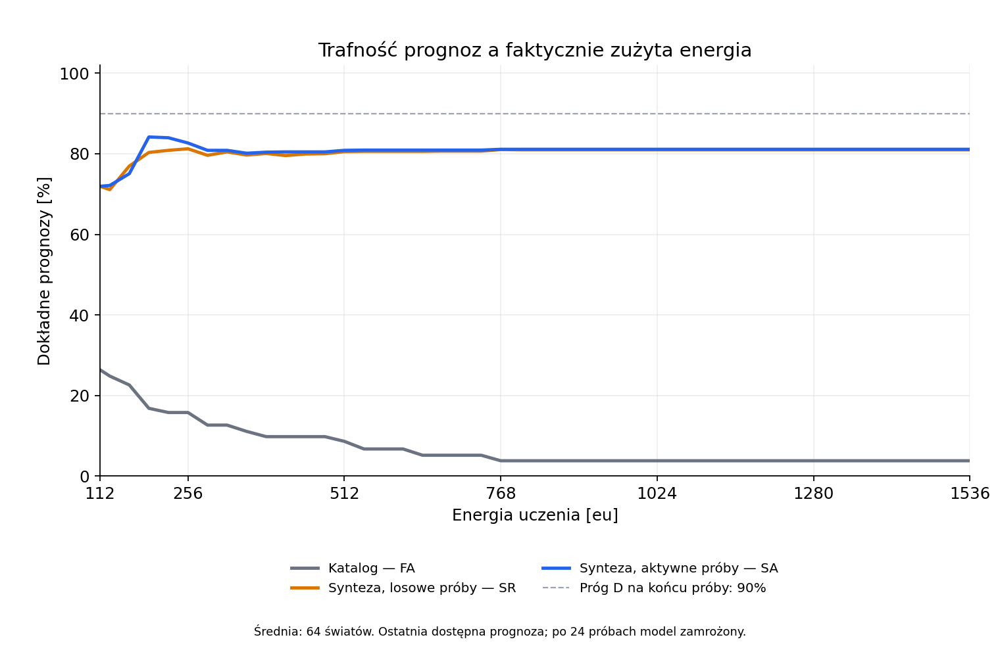

# Budowanie wyjaśnień — wykonanie hypothesis-v1

**Status: implementacja i jednorazowa próba wykonane. Pełne kryteria H i A nie zostały spełnione.** Data: 27.10.2026. To prawidłowy negatywny wynik badania, z działającym mechanizmem syntezy i rzeczywistymi pomiarami. Techniczny odbiór kodu nie jest potwierdzeniem hipotez naukowych. M04 oraz plan M05/M06 zachowują swój odrębny zakres.

[Zatwierdzony protokół](../work-items/hypothesis-building-experiment.md) pozostaje właścicielem metody i progów. [API](../hypothesis-building.md) opisuje implementację, [plan](../work-items/hypothesis-building-implementation.md) wykonanie, a [review](evidence/hypothesis-building-2026-10-27/review.md) uwagi niezależnego recenzenta i poprawki autora. Nie zmieniano gramatyki, progów, wejść 1–64, seedów ani zasad oceny po obejrzeniu wyników.

## Co wykonano i co dostarczyliśmy

Agent otrzymuje początkowy katalog F i język składania strat, ograniczeń, ułamków i progów. Po sprzeczności z F generuje programy długości 0–3, usuwa równoważne zapisy i filtruje je rzeczywistymi obserwacjami. Język ma 20440 zapisów przed usunięciem równoważności; jest skończoną przestrzenią dostarczoną przez autorów. Generowanie składni w czasie działania nie oznacza wynalezienia operatorów lub otwartej ewolucji. Agent nie otrzymuje prawdziwego programu, seedu ani odpowiedzi sędziego.

W każdym świecie porównano trzy odrębne sesje: FA — katalog z aktywnymi próbami; SR — synteza z losowymi próbami; SA — synteza z aktywnymi próbami. Każdy wariant wykonał 24 różne fizyczne pomiary wejść 1–64. Początek 16/32/64 był wspólny. Utrwalano prognozy dla 24 niepróbowanych zadań po prefiksach 3–24, a sędzia oceniał je po zamknięciu przebiegu. Cele zależne od prawdy były dostępne dopiero po zamrożeniu modelu. Ocena użyteczności wymagała rzeczywistego impulsu w jawnej nowej sesji, bez uczenia z wyniku.

Przygotowano 64 światy główne oraz po 16 kontroli prostych i poza językiem: razem 96 przypadków i 288 wariantów. To 6912 impulsów uczenia. W głównej próbie 64 seedy dały 61 różnych tabel praw; powtórzenia były dozwolone losowaniem ze zwracaniem. Jednostką statystyczną jest świat, a nie każdy impuls. Dwadzieścia dodatnich celów na świat losowano z osiągalnych par ze zwracaniem. Pula liczyła 8–58 par; w 20 zadaniach występowało 8–20 różnych par, średnio 12,453125. Liczby zadań nie są liczbami niezależnych odkryć.

## Zamrożenie i integralność

Końcowy rozwój i potwierdzenie wykonały ten sam binarny Release/RelWithDebInfo: SHA-256 `0f2ca5ed14dc0513623003a0c38c46ce9b17fc12cbe635a18f4f01b3e2fd4fd0`. Potwierdzający freeze powstał z czystego commitu `d017f5bb12604b69397d7cf24f8c723bfe7329c1` o `2026-10-27T20:15:53Z`, **przed generowaniem potwierdzających praw i celów**. Zachowuje 113 plików źródeł, protokół, rekord gotowości, narzędzia i binarium. Źródła późniejszych opisowych wykresów nie sterują eksperymentem.

Narzędzia: Windows x64, MSVC 19.44.35226.0, CMake 4.4.4, MSBuild 17.14.40.60911, Python 3.11.9; konfiguracja badania RelWithDebInfo, ASan OFF. Dokładne ścieżki, wersja OS/Pythona, hashe definicji kompilatora i konfiguracji są w freeze. [Rekord review](evidence/hypothesis-building-2026-10-27/review-record.json) zachowuje niezależny werdykt WITH FIXES i późniejsze READY integrującego, związane z hashami poprawionych źródeł i kontroli. Nie podszywa się pod drugi niezależny przegląd.

`RUN.started.json` powstał raz. Próba i późniejszy `analyze` ukończyły się bez błędu infrastruktury. Niezależny Python odtworzył wszystkie wybory prób, prognozy, liczniki, pomiary, wykonania celów oraz bilanse. Test ponownego uruchomienia istniejącej próby odmawia; pierwotnych danych nie zastępujemy rerunem. Analizator sprawdza także przypadki odtworzone z zamrożonego generatora, manifesty, marker i wynik zapisany w wierszach/podsumowaniu.

## Wynik główny

| Wariant | Dokładne prognozy D | Fizycznie osiągnięte dodatnie cele G |
| --- | --- | --- |
| FA — katalog | 58/1536 = 3,7760% | 46/1280 = 3,5938% |
| SR — synteza, losowe próby | 1244/1536 = 80,9896% | 1238/1280 = 96,7188% |
| SA — synteza, aktywne próby | 1246/1536 = 81,1198% | 1236/1280 = 96,5625% |

**H: brak wsparcia pełnego kryterium.** SA zarejestrował sprzeczność i zgodny wówczas program poza F w 61/64 światach = 95,3125%. G przekroczył 80%, przyrost D nad FA wyniósł 77,34375 punktu procentowego, a G — 92,96875 pp. Oba testy znaków miały 61 zwycięstw i trzy remisy, `p = 1/2^61`, poniżej `0,05/3`. Jednak **D = 81,1198% nie osiągnął zapisanego progu 90%**. Istotna poprawa wobec niedostatecznego katalogu nie zastępuje brakującego warunku.

**A: brak wymaganej przewagi aktywnego wyboru nad losowym.** Miara to średnia dokładność po 22 prefiksach 3–24, a nie wyłącznie końcowy wynik. SA: `9121/11264`; SR: `9029/11264`. Przyrost wyniósł `23/2816`, czyli **0,816761 pp**, wobec wymogu 5 pp. Test znaków: 23 zwycięstwa, 30 remisów, 11 porażek; `p = 123722273/4294967296 ≈ 0,0288063`, wobec progu `1/60 ≈ 0,0166667`. SR osiągnął o dwa cele więcej niż SA. Nie wykazano wyższości aktywnej metody.

## Rozbicie jakości i niepewności

SA trafił 340/512 prognoz pojedynczego u = 66,40625%, a 906/1024 prognoz łańcuchów = 88,47656%. Łańcuchy mogą zmniejszać wejście przed u przez znane v/w; wysoki wynik łańcuchów nie jest pełnym dowodem trafnej ekstrapolacji samego nieznanego elementu.

Z 269 prognoz o rzeczywistym wyjściu zero SA trafił 268. Z 1267 dodatnich wyjść trafił 978. Podstawowe cele G były wszystkie dodatnie; wyniku G nie uzyskano przez celowe wyzerowanie urządzenia. Oddzielne diagnostyki zera pozostają w surowych danych i nie wchodzą do G.

SA wydał wszystkie 1536 prognoz. Przedział min–max obejmował rzeczywisty wynik w 1522/1536 przypadków = 99,0885%; średnia szerokość wynosiła 5,78385 eu, maksimum 112 eu. To przedział pozostałych modeli, a nie statystyczny przedział ufności. Spośród 1183 jednogłośnych prognoz 1169 było trafnych. **Czternaście jednogłośnych, błędnych prognoz pozostaje porażką**, mimo wysokiego pokrycia pozostałych przedziałów.

W trzech światach SA nie obalił F w 24 pomiarach: seedy `0x48591001`, `0x48591004`, `0x48591032`. Ich D wyniosło odpowiednio 10, 24 i 24. Trafny wynik testu może zatem współistnieć z brakiem rozpoznania nowej struktury. W `0x48591001` prawem było progowanie przy 4, połowa przepływu i limit 32. Przeprowadzone pomiary utrzymywały prostą regułę połowy; nie ujawniły jej błędności. Wszystkie 14 błędnych jednogłośnych odpowiedzi SA przypada na tę sytuację. To ograniczenie inicjowania syntezy dopiero po sprzeczności, nie ukryty odczyt świata.

## Konkretna niejednoznaczność — diagnoza po próbie

W rzeczywistym świecie `0x48591000` pozostało osiem modeli. Dwa z nich:

```text
f(x) = floor(3 * max(0, x-48) / 4)
g(x) = floor(3 * min(max(0, x-48), 16) / 4)
```

Są identyczne dla **każdego** dozwolonego wejścia uczenia 1–64. Przy 96 dają odpowiednio 36 i 12. To nie tylko brak konkretnej dwudziestej piątej próby: nawet wszystkie pomiary w dopuszczonym obszarze nie rozstrzygnęłyby między tymi wyjaśnieniami. Rzeczywistym prawem było f, a g należało do dostarczonej gramatyki i zgadzało się z doświadczeniami. [Zapis diagnozy](evidence/hypothesis-building-2026-10-27/ambiguity-example.json) wiąże obie tabele z hashem natywnego dowodu.

To opisowa analiza po zamknięciu wyniku, a nie nowy potwierdzony endpoint. Uzasadnia ograniczenie interpretacji: model może uczciwie zachować niepewność i działać użytecznie, nie mając jednej rozstrzygniętej teorii. Zadanie z podanym osiągalnym celem niesie też inną informację niż swobodna prognoza wyjścia; G nie zastępuje D. Nie rozszerzaliśmy wejść w trakcie próby.

## Kontrole i rozwój

- 16 prostych światów F: wszystkie trzy warianty uzyskały D = 100% i G = 100%; synteza nie uruchamiała się. Kontrola nie wykazała utraty istniejącej umiejętności.
- Cztery kwadratowe prawa poza językiem, po cztery seedy: wszystkie warianty uzyskały końcowe D/G = 0; wszystkie 16 końcowych zbiorów modeli SA było pustych. Powstałe przejściowo zgodne programy nie przetrwały dalszych pomiarów. To kontrola czterech praw, nie reprezentacja dowolnego świata spoza języka.
- Rozwój początkowy i końcowy: po 16 światów głównych oraz 32 kontrole. SA: D = 343/384 = 89,3229%, G = 100%, H/A niespełnione. W końcowym kodzie uzyskano te same wyniki naukowe. Zachowano obie serie i różnice warstwy technicznej. [Porównanie historycznych stanów](evidence/hypothesis-building-2026-10-27/historical-state-compatibility.json) potwierdza 288 identycznych bajtowo snapshotów pomiędzy seriami.

## Koszt i granice pomiaru

Każdy wariant wykonał 24 próby i nie przekroczył 1536 eu / 1000 kroków. Samo uczenie trwało 48 kroków świata, czyli 2,4 s świata; zegar nie był czasem CPU. Źródło każdej sesji miało 8192 eu. Energia oceny jest oddzielną księgą; nie stanowi bezpłatnego treningu.

| Koszt na świat główny | FA | SR | SA |
| --- | --- | --- | --- |
| Średnia energia uczenia [eu] | 799,25 | 799,25 | 798,25 |
| Zakres energii uczenia [eu] | 685–917 | 685–917 | 679–953 |
| Średni / maksymalny czas ścienny [ms] | 18,44 / 37,49 | 53,00 / 96,73 | 52,08 / 97,44 |
| Średni czas CPU [ms] | 18,80 | 52,49 | 50,54 |
| Średnie zastosowania prymitywu | 13158 | 7468543,69 | 7468543,69 |
| Średnie / maksymalne odczyty modeli | 223,61 / 1454 | 10255,36 / 29936 | 11850,98 / 32315 |

Żaden wariant główny nie wyczerpał budżetu obliczeń. Maksimum zastosowań prymitywu wyniosło 7835202 wobec limitu 10000000. Kontrolowane regresje osobno sprawdzają wyczerpanie w trakcie prognozy i planowania, zachowanie wcześniejszych deklaracji, 24 dalsze pomiary bez wnioskowania oraz brak odnowienia limitu po odczycie i wejściu w ocenę.

Pomiary natywne obejmują konstrukcję sesji, naukę, deklaracje, fizyczną ocenę i zapis dwóch snapshotów. Czas CPU ma rozdzielczość systemowych liczników. **Peak jest kumulatywnym szczytem całego procesu**, w którym FA/SR/SA są wykonywane kolejno; maksimum wszystkich 96 procesów wyniosło 8925184 bajty, około 8,51 MiB. Nie przypisujemy niezależnych szczytów pamięci wariantom i nie liczymy tu procesu eksperymentatora Python, kompilatora ani renderera. Nie ma dowodu wydajności większej populacji lub docelowej gry. Stała kolejność, cache i brak kontrolowanych powtórzeń ograniczają porównanie czasu; nie twierdzimy, że SA jest szybszy albo oszczędniejszy.



[SVG](evidence/hypothesis-building-2026-10-27/learning-curves.svg), [punkty energii CSV](evidence/hypothesis-building-2026-10-27/learning-curves.csv), [prefiksy CSV](evidence/hypothesis-building-2026-10-27/prediction-prefixes.csv). Wykres pokazuje ostatnią dostępną prognozę przy danym koszcie, utrzymywaną po 24 próbach; nie jest nowym testem A. Artefakt utworzono istniejącym Matplotlib 3.10.0 z lokalnego środowiska autora, na licencji dystrybucji Matplotlib; [źródło narzędzia](https://github.com/matplotlib/matplotlib). Nie instalowano pakietów i nie dodano zależności silnika, runnera ani testów. Obraz został obejrzany po renderowaniu.

## Weryfikacja techniczna i zachowane porażki

| Kontrola końcowych źródeł | Wynik |
| --- | --- |
| `cmake --preset windows-msvc`, build Debug, `ctest --preset windows-debug` | 324/324 PASS, 116,68 s |
| build Release, `ctest --preset windows-release` | 324/324 PASS, 43,89 s |
| `cmake --preset windows-asan`, build ASan, `ctest --preset windows-asan` | 326/326 PASS, 186,87 s |
| `cmake --build --preset windows-debug --target format-check` | PASS |
| `python -m unittest discover -s tools/tests -p "test_*.py"` | 47/47 PASS |
| `python tools/check_docs.py` | PASS |
| Niezależny `analyze` rozwoju i potwierdzenia | PASS |
| Analiza rozpakowanej kopii potwierdzenia w innej ścieżce | PASS |

[Logi techniczne](evidence/hypothesis-building-2026-10-27/manifest.json) zachowują również RED i wcześniejsze kontrole: brakujące implementacje, błędy nazw współrzędnych przy pierwszym buildzie, nieprzechodzące regresje selektora/filtra budżetu i rezerwy dziennika oraz źle dobrane wywołanie w pierwotnym teście kontynuacji. Test uruchomiony po nieudanym buildzie użył starego programu i nie stanowi odbioru nowych źródeł. Początkowy pełny ASan 323/324 zakończył się błędem `tooling.tests`, gdy dodane regresje review/proweniencji wykazały brak helperów przed poprawką; końcowy ASan powyżej zawiera poprawki. To jawne etapy RED, nie ukryte wyniki zielone. Nie zmieniono limitów czasu ani nie pominięto testów.

Pierwszy analizator kopii freeze utworzył dwa pliki bytecode cache i ścisły manifest je odrzucił. Przeniesiono wyłącznie te dodatkowe cache do technicznych dowodów, zachowując pierwotne hashe danych; archiwalny analizator z `python -B` przeszedł. Końcowy czytnik wyłącza bytecode przed lokalnymi importami, a jego regresja przechodzi. Zmienione moduły analizatora są odrzucane względem freeze. Zachowano początkową serię i wszystkie powyższe logi; nie podmieniono jej końcowym przebiegiem.

Nowe zapisy używają odrębnego `GENESIS_HYPOTHESIS 1` i `DWORLD 2`; stare formaty nadal mają regresje. [Osiem zatrzymanych przebiegów i ich kontynuacje](evidence/hypothesis-building-2026-10-27/continuation.zip) pochodzi z rzeczywistych nowych procesów, uruchomionych zamrożonym binarium. Obejmują dwa sterowniki i cztery momenty przed/po sprzeczności oraz konfiguracji/impulsu. `--continue` jest tu konsumentem suffixu fixture'a; ogólne ładowanie stanów, także końcowej oceny, zapewnia API sesji. Odtwarzanie historii przy odczycie zużywa CPU i nie jest dowodem skalowalności formatu. Nowy widok 3D i ludzki odbiór gry nie były częścią tego przyrostu.

Końcowe `git diff --check` obejmujące również bajtowo zachowane dowody zgłosiło ich CRLF oraz treść historycznych diffów. Nie zmieniano logów, CSV ani snapshotów dla wyciszenia tej kontroli. Oddzielna kontrola źródeł i bieżącej dokumentacji przeszła; integralność surowych dowodów sprawdzono kompletem hashy. Kontrola formatu C++ i testy pozostają bez osłabiania reguł.

## Odtworzenie dowodu

Zachowano kompletne, przenośne pakiety: [rozwój początkowy](evidence/hypothesis-building-2026-10-27/development-initial.zip), [rozwój końcowy](evidence/hypothesis-building-2026-10-27/development-final.zip), [potwierdzenie](evidence/hypothesis-building-2026-10-27/confirmatory.zip). Zawierają binarium Windows x64, zamrożone źródła, przypadki, fizyczne stany, surowe wyniki, manifesty i jednorazowe markery. ZIP chroni historyczne kopie Markdown przed traktowaniem ich jako nowych dokumentów normatywnych projektu. Hashe ZIP/logów/wykresów wskazuje [manifest](evidence/hypothesis-building-2026-10-27/manifest.json).

Po rozpakowaniu potwierdzenia do nowego katalogu można bez uruchamiania kompilatora wykonać:

```powershell
python -B build/hypothesis-portability-check/frozen-source/tools/run_hypothesis_experiment.py analyze build/hypothesis-portability-check
```

To dokładna kontrola wykonana dla rozpakowanego pakietu; nie ponowna próba statystyczna. Przeniesiony pakiet przeszedł analizę wszystkich 96 przypadków. Aktualny skrypt projektu może później odmówić analizy starego freeze, dlatego używa się jego kopii. Pierwotne przygotowanie potwierdzenia:

```powershell
python tools/run_hypothesis_experiment.py prepare --mode confirmatory --exe build/msvc/RelWithDebInfo/reality_hypothesis.exe --output build/hypothesis-confirmatory-01 --review docs/verification/evidence/hypothesis-building-2026-10-27/review-record.json --development build/hypothesis-development-02
python tools/run_hypothesis_experiment.py run build/hypothesis-confirmatory-01
python tools/run_hypothesis_experiment.py analyze build/hypothesis-confirmatory-01
```

## Wniosek i dalsza decyzja

Wykonano ograniczoną syntezę programów po obaleniu katalogu i użyteczne działanie na ich podstawie. Nie osiągnięto zatwierdzonej jakości ekstrapolacji, a badany aktywny wybór prób nie wykazał wymaganej przewagi. Własne doświadczenie bywa niewystarczające do rozstrzygnięcia praw; jednomyślność ograniczonego katalogu może być błędna. Tych trzech obserwacji nie wolno zastąpić hasłem o samodzielnej inteligencji.

Uzasadniony następny przedmiot projektowania to sposób zdobywania rozstrzygających doświadczeń i sprawdzania własnych założeń: kiedy potrzebny jest szerszy zakres interwencji, a kiedy dodatkowe pomiary w dotychczasowym. To nowe pytanie badawcze, bez poprawiania wstecz wyniku H/A. ALife, reprodukcja, ekologia, otwarta ewolucja, świadomość i zintegrowana cywilizacja pozostają odrębnymi torami. [Ocena rozmowy o ABSS](../research-agenda.md#ograniczenia-interpretacji) porządkuje tę szerszą wizję; nie dodaje nowych systemów do wykonanego eksperymentu.
